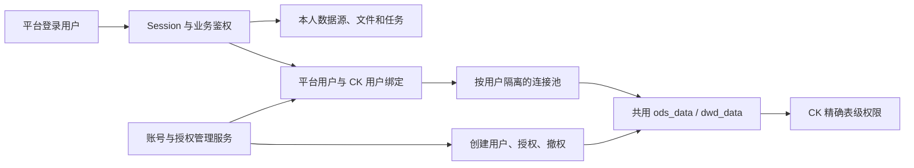

# CK 真实用户与表级权限开发方案

版本：1.0  
日期：2026-10-20  
状态：开发设计；最新管理员规则与验证以 [el-admin 库表权限修正记录](el-admin库表权限修正记录.md) 为准；其他阶段验证见 [CK 权限实现验证记录](CK权限实现验证记录.md)。

## 1. 已确认需求

1. 平台创建用户时，在指定 ClickHouse 实例中创建并绑定真实 CK 用户。
2. 共用现有 `ods_data`、`dwd_data` 等业务库，**不为每个人创建独立库**。
3. 普通用户使用精确表级权限：访问自己的表，以及别人共享给自己的表。内置 admin 按第 8 条执行。
4. **不增加“共享给我的表”菜单**。原标准源表、目标表等列表合并展示本人和获授权的表，增加“创建者”列。
5. 外部数据源配置、上传文件、任务、工作流和 SQL 草稿绑定平台用户。
6. 新增用户仍放在独立用户管理菜单中。
7. 验证完成后，删除本次开发新增的测试代码及临时验证文件，保留验证结果记录。
8. 2026-10-20 最新确认：平台内置 `admin`（用户名、角色均为 admin）绑定配置的 CK 业务账号 `el-admin`，两个业务库的表列表按该 CK 账号实际可见范围展示，包括普通用户创建的表；读写受 CK 原生授权约束。普通用户继续使用 `el_user_<userId>`。该规则替代此前“admin 与 user 也隔离”的选择，admin 同时保留平台账号管理能力。
9. 两个业务库作为可用目录显示，即使尚未创建表；显示库名不等于获得库内全部表的读写权限。
10. 当前没有历史数据需要重新分配，移除“历史数据归属”菜单和页面路由。本文历史迁移章节仅作未来有旧数据时的参考，不是本次上线步骤。

共享对象选择：打开共享弹窗即列出启用用户的账号名，排除本人，最多显示 50 条；支持输入账号名搜索。该目录只返回用户 ID 和账号名，不向普通用户开放完整账号管理接口。

本文替代旧设计中的个人独立库、独立共享菜单方案。已有代码中的共享页面、受控预览及执行限制属于过渡实现，不能作为本方案已完成的依据。

## 2. 目标效果

| 实际表 | 创建者 | 张三权限 | 李四权限 |
| --- | --- | --- | --- |
| ods_data.customer | 张三 | 读取、允许的写入及管理、共享 | 无 |
| ods_data.orders | 李四 | 无 | 读取、允许的写入及管理、共享 |
| dwd_data.customer_report | 张三 | 读取、允许的写入及管理、共享 | 共享后只读 |

李四登录后，原列表显示 `orders` 和已共享的 `customer_report`，不显示 `customer`。`customer_report` 的“创建者”始终显示张三。

普通用户直接输入未授权的完整库表名查询，也必须被 CK 拒绝；不能只依靠前端隐藏和平台列表过滤。内置 admin 使用已有库级授权访问这些表，不需要其他用户先共享。

创建者与当前所有者分别记录。历史分配或后续移交不修改原始创建者；无法确定创建者的历史表显示“历史数据 / 创建者未知”，不把接收人伪装成创建人。

## 3. 架构与身份



平台元数据库管理归属、创建者、共享关系和操作任务；CK 管理真实账号及实际数据访问权限。两层同时生效。

### 3.1 账号绑定

- 以不可变的 `user_id` 关联真实 CK 用户，不能仅凭用户名匹配。
- 建议 CK 用户名由服务端生成，如 `el_user_42`，在用户管理中展示实际绑定名称；修改平台显示名不影响绑定。
- 内置 admin 例外：绑定该实例已配置的业务连接账号（如 `el-admin`），使用配置凭据，不创建独立 `el_user_1`；启动时自动核对并更新绑定，不改平台登录密码或 CK 账号密码。业务账号与专用授权管理账号分开。
- 平台登录保留 Session、CSRF、强制改密和禁用机制。
- CK 执行凭据建议采用独立随机密码，后端加密保存，供查询和无人值守任务使用，不返回浏览器。
- 真实 CK 用户不等于必须与平台共用密码。用户直连 CK、统一平台和 CK 密码不在本期默认范围。
- 每个获准使用的 CK 实例建立单独绑定。多个连接别名指向同一实例时，统一到一个 `ck_instance_id`，防止重复占用表名或重复授权绕过检查。

### 3.2 连接用途

| 用途 | 身份 | 允许操作 |
| --- | --- | --- |
| 账号和授权管理 | 专用管理身份 | 创建用户、精确授权、撤权及核对 |
| 交互业务操作 | 当前用户的 CK 身份 | 已授权范围内的查询、写入及受控表操作 |
| 定时、异步任务 | 任务所有者的 CK 身份 | 已授权任务执行 |

管理连接不得执行用户传入的任意业务 SQL。绑定不存在、用户禁用、初始化失败或权限异常时直接拒绝，不能回退到 `default`、公共连接账号或管理员。

## 4. 权限规则

| 能力 | 所有者 | 共享接收者 |
| --- | --- | --- |
| 列表、结构、预览、SELECT | 允许 | 授权生效后允许 |
| INSERT、修改数据 | 按开放功能允许 | 不允许 |
| 清空、整理、修改结构 | 按开放功能允许 | 不允许 |
| 删除、改名、重建 | 通过受控生命周期接口 | 不允许 |
| 共享、撤销共享 | 允许 | 不允许 |
| 作为任务写入目标 | 允许 | 不允许 |

首期结构化同步及工作流输入仍限本人表，共享首先提供读取能力。这是平台任务入口的规则，不代表能阻止用户通过 SQL 复制已经获准读取的数据。

共享“只读”表示不能修改原表，不表示禁止保存查询结果。允许 SELECT 后，不能靠隐藏导出按钮承诺数据无法复制；撤销共享不能收回已读取或复制的数据。

### 4.1 CK 授权组织

- 每张表建立一个平台管理的读取角色，例如 `el_t_101_g1_read`，包含资产 ID 和生命周期代次。
- 角色仅授予该表 SELECT，分配给所有者及有效共享接收者，并配置默认激活。
- 所有者写权限按业务所需精确授予到表，避免授予宽泛的 ALTER 权限组。
- 普通用户不获得账号管理、角色管理、转授、任意外部数据源访问或跨用户取消查询能力。
- 不授予 `SELECT ON ods_data.*`、`INSERT ON dwd_data.*` 等覆盖他人表的库级通配权限。
- 删除、改名、重建等生命周期 DDL 由受控流程办理，不长期开放自由生命周期 DDL。

CK 支持精确表级授权；CREATE TABLE 也是表级权限，可以针对尚未存在的表名预先授权。权限语法和隐含权限须按实际服务器版本验证。[GRANT 文档](https://clickhouse.com/docs/reference/statements/grant)、[访问控制文档](https://clickhouse.com/docs/concepts/features/security/access-rights)

权限关系示意（不是未经核对即可执行的部署脚本）：

```sql
CREATE ROLE el_t_101_g1_read;
GRANT SELECT ON ods_data.customer TO el_t_101_g1_read;
GRANT el_t_101_g1_read TO el_user_42;
-- 共享给用户 43
GRANT el_t_101_g1_read TO el_user_43;
-- 撤销用户 43 的共享
REVOKE el_t_101_g1_read FROM el_user_43;
```

需要同时检查角色是否激活、继承角色和直接授权是否带来额外访问权；不能只看到一条 GRANT 成功就认为权限正确。

## 5. 核心业务流程

### 5.1 新增用户

1. 用户管理提交账号及允许使用的 CK 实例。
2. 元数据事务保存平台账号、pending 绑定和初始化操作任务。
3. 管理服务创建 CK 用户，设置独立随机凭据及必要的会话约束。
4. 使用新用户连接，核实 `currentUser()` 和初始有效权限。
5. 成功转为 active；失败转为 failed，显示脱敏原因并允许重试。

新用户没有业务表权限，空列表是正常状态。同名 CK 用户不能自动认领；必须确认其由同一初始化操作创建，已有外部用户另走管理员显式绑定流程。

### 5.2 新建表及同步自动建表

首期沿用用户填写的真实表名，不自动添加用户前缀。同一实例、同一库中，同名表只能有一张；冲突提示“表名已占用”，不暴露对方结构或创建者。

1. 校验账号、CK 绑定和目标库范围。
2. 原子占用 `(ck_instance_id, database_name, table_name)`，创建 provisioning 资产，记录创建者、所有者及操作 ID。
3. 核对 CK 实际对象。已存在但未登记的表属于待处理历史对象，不由当前请求自动认领。
4. 核对该精确位置是否有旧角色或直接授权。无法解释的遗留权限应暂停处理，不能带着旧授权创建新表。
5. 临时授予用户精确目标表的建表权限，以该用户身份执行服务端生成的结构化建表语句。管理连接不代跑用户任意 SQL。
6. 核实物理表并记录其标识，授予读取和允许的写权限，撤掉临时生命周期权限。
7. 全部成功后资产转为 active，任务才能开始写入。

失败或结果不确定时保持不可用并进入恢复任务，不能用 `CREATE TABLE IF NOT EXISTS` 把已有表当成自己创建成功。补偿删除前核对操作 ID、物理标识和已有数据，不盲删同名对象。

两个用户并发抢同名表，只能一个成功。元数据唯一约束和状态转换负责串行化，不能只依赖先查询再插入。

### 5.3 列表与创建者

列表取当前用户拥有的 active 表及已完成 CK 授权的 active 共享表，再用当前用户 CK 身份核对实际可用状态。异常对象不标记为可用。

- 标准源表、目标表及表详情增加“创建者”字段。
- 查看入口可包含共享表；任务写入目标只能选择本人可写表。
- 共享表不显示修改、清空、删除及共享管理按钮，后端仍重新鉴权。
- 分页和总数以可见范围计算，不能返回全库总数。
- 已有共享过渡页面的能力迁入原列表/详情，旧地址可重定向，不保留独立共享菜单入口。

### 5.4 共享和撤销

共享：校验所有者 → 保存 pending 共享和操作任务 → CK 授予读取角色 → 核对生效 → 转为 active。失败保持待处理状态，不提前提示成功。

撤销：先改为 revoking 并阻止平台新的相关访问 → CK 撤销角色 → 核对没有其他授权路径 → 清理缓存并完成。失败保留 revoking、自动重试，并显示“CK 撤权尚未完成”。

撤销期间，对接收者在该实例上的自由 SQL/新执行请求暂时阻断，避免通用 SQL 使用尚未撤掉的 CK 权限。

元数据库和 CK 没有本地事务原子提交，采用持久化操作、幂等、重试和对账。任务按资产＋接收者串行执行，携带期望版本；旧共享任务不能在新撤销操作之后重新授权。CK 网络操作不放在长时间持有行锁的元数据事务中。

已运行查询尽力取消并报告结果，已返回数据无法撤回。CK 不可达时不能声称数据库侧撤权已经完成。

### 5.5 删除、改名与重建

统一经过生命周期服务：阻断新操作、处理依赖任务 → 撤销旧权限 → CK DDL → 更新资产状态。

- 改名要同时占用新名字、核对旧对象物理标识，再配置新名字权限。
- 重建产生新的生命周期代次，旧共享默认不继承，需所有者重新确认。
- CK 删除表后对应授权可能保留，因此必须显式清理旧授权，防止同名新表继承权限。[权限生命周期说明](https://clickhouse.com/docs/concepts/features/security/access-rights)
- 本期不开放不受控的用户直连 DDL。运维外部改表、改授权通过对账识别并隔离异常资产；不能承诺定时对账发现之前没有窗口。

### 5.6 禁用账号和后台执行

禁用立即撤销平台会话、阻止新任务、关闭该用户连接缓存；持久化 CK 禁用/凭据轮换操作并核对完成状态。实际数据库禁用方式按版本实现。

后台执行只使用任务持久化所有者，执行前重新检查账号、绑定、数据源和表权限。禁用用户不直接删除业务表。内置 admin 的 CK 库表访问按已有原生授权执行，不扩展为其他用户的数据源、文件或任务访问权；其他管理员角色账号仍按独立绑定隔离。

## 6. 外部数据源、文件与任务

- 复用 `el_resource_owners` 管理数据源、任务、工作流和 SQL 草稿，避免新增一套互相冲突的 owner 字段。
- 所有者从会话取得，普通创建接口不接受任意所有者 ID。
- 列表、详情、测试连接、源表枚举、预览、编辑和删除均校验数据源归属；状态缓存按用户隔离。
- 外部 MySQL、PG、SFTP 使用其原有外部系统凭据，不能替换成 CK 用户密码。CK 用户控制的是同步后的 CK 表。
- 文件路径继续按用户隔离，读取时校验归属。
- 共享 CK 表不共享其外部数据源密码、上传文件、任务、日志和 SQL 草稿。
- 同步优先由应用读取已授权外部源，再经任务所有者 CK 连接写入。现有依赖 CK 外部表函数的路径逐项审计，不为方便同步开放任意 FILE、URL、REMOTE 等能力。

## 7. 元数据设计

以下为逻辑字段设计。新增版本迁移，不修改已执行的 V5 脚本；DDL 按实际 MariaDB/MySQL 版本核对。

### 7.1 实例和 CK 用户绑定

新增 `el_ck_instances` 统一表示实际 CK 实例或集群，连接配置引用该实例。集群部署须保证各节点账号及授权一致，不能仅初始化一个节点。

新增 `el_user_ck_bindings`：

| 字段 | 说明 |
| --- | --- |
| id、user_id、ck_instance_id | 用户＋实例唯一 |
| ck_username、ck_user_uuid | 实际账号及可取得的物理标识 |
| credential_ciphertext、credential_version | 加密凭据及连接失效版本 |
| status | pending / active / failed / disabling / disabled |
| last_error、last_verified_at | 脱敏错误及核对时间 |
| created_at、updated_at | 生命周期时间 |

同一实例内 CK 用户绑定唯一，删除绑定不自动删除表。

### 7.2 扩展表资产

复用 `el_data_assets`，为 CK 资产补充：

| 字段 | 说明 |
| --- | --- |
| ck_instance_id | 物理位置按真实实例统一 |
| creator_user_id、creator_name_snapshot | 原创建者；历史未知可为空 |
| owner_user_id | 当前所有者，沿用现有字段 |
| generation、physical_table_uuid | 生命周期代次和物理对象核对信息 |
| status | provisioning / active / changing / deleting / missing / failed / deleted |
| origin_type、origin_id | 同步、工作流或历史登记来源 |
| permission_version | 权限对账版本 |

增加当前表名占用记录，实例＋库＋表唯一。删除资产保留历史，旧授权清理后才能释放名字；同名重建不能复用旧资产和共享。迁移时处理现有位置唯一约束及多个连接重复登记同一物理表的问题。

### 7.3 授权操作和审计

- `el_resource_grants` 增加权限类型、状态、期望版本、已应用版本和脱敏错误信息；“存在记录即放行”改为“状态有效且完成授权”。
- 新增 `el_ck_access_operations`：操作 ID、幂等键、对象/用户、动作、期望版本、状态、尝试次数、下次重试时间、租约、错误信息。
- 复用并扩展 `el_access_audit`：记录请求人、实际执行身份、动作、结果和操作 ID，不记录密码或完整敏感 SQL。
- 旧共享记录转入待核对状态，不直接声称已完成 CK 授权。

## 8. 后端改造清单

| 位置 | 改造内容 |
| --- | --- |
| AppUserController / AccountSecurityService | 新建、禁用与 CK 初始化联动，返回状态 |
| 新 CkIdentityService | 实例绑定、凭据解析、有效状态检查 |
| 新 CkAccessProvisioner | 受控账号和授权指令、实际结果核对 |
| 新 TableLifecycleService | 表名占用、建表、改名、删除、重建及补偿 |
| 新 CkAccessReconciler | 持久任务恢复、权限对账、漂移检测 |
| ConnectionService | 区分业务、临时与管理连接；业务配置使用绑定身份 |
| CkPool | 缓存键包含实例/连接、用户、凭据版本和连接配置版本；支持按用户失效 |
| ResourceAccessService | 创建者、有效共享状态和读取角色联动 |
| TableService / DatabaseService | 当前用户身份读取实际状态，统一列表与生命周期 |
| QueryService | 查询、分页、导出和结构探测全部使用用户身份 |
| SyncService / SyncEngine | 受控建表、来源归属、任务身份及产物登记 |
| 各 WorkflowService | 源和产物权限、临时表、物化视图、刷新及取消身份 |
| ResourceBoundaryInterceptor | 按验收完成的接口逐步放开，不一次删除保护 |
| MysqlMetadataSchema / MetadataSqlDialect | 新迁移注册、逻辑表映射及 MariaDB 兼容性 |

共享连接配置不能就地修改用户名/密码，必须复制后组装。任何异常分支不得静默切换管理账号。

SQL SECURITY、物化视图、Distributed 表、字典、外部引擎可能具有独立执行身份，须单独验证；普通 SELECT 隔离完成不代表可以直接开放全部工作流。

## 9. 接口和页面

优先扩展现有接口，不重复增加菜单。

| 接口 | 设计 |
| --- | --- |
| GET /api/app-users | 返回 CK 绑定和初始化状态摘要 |
| POST /api/app-users | 创建平台账号并登记所选实例初始化操作 |
| POST /api/app-users/{id}/ck-bindings/{bindingId}/retry | 管理员重试初始化，不接受任意 SQL |
| 原表列表/详情 | 增加创建者、所有者、当前用户权限和状态 |
| 现有共享/撤销接口 | 返回操作 ID 和处理状态，完成后才提示成功 |
| GET /api/access-operations/{id} | 仅相关用户或有权限的管理员可查 |
| 原建表/删除/改名接口 | 接入生命周期和幂等操作流程 |

表列表 DTO 示例：

```json
{
  "assetId": 101,
  "database": "dwd_data",
  "table": "customer_report",
  "creatorUserId": 42,
  "creatorName": "张三",
  "ownerUserId": 42,
  "accessMode": "read",
  "canRead": true,
  "canWrite": false,
  "canManage": false,
  "canShare": false,
  "permissionStatus": "active"
}
```

权限字段只由服务端计算。前端提交 `canManage=true` 不能改变权限；错误消息不向无关用户暴露敏感表或凭据。

前端工作项：

1. 标准源表、目标表及其他相关表列表增加“创建者”，共享表直接合并显示。
2. 同名跨库表保留数据库信息，操作按资产 ID 定位。
3. 现有行操作或详情内管理共享；只读表收起写操作。
4. 用户管理显示 CK 绑定状态、脱敏失败信息和重试按钮。
5. 将已有 SharedDataView 的能力迁入原页面，移除独立菜单入口。

## 10. 历史数据迁移

本项目当前无需历史数据重新分配，不提供该菜单。以下仅作未来迁移参考。admin 查看尚未登记的平台外 CK 表时不自动认领，创建者显示“创建者未知”。

1. 盘点真实 CK 实例、版本、账号方式、库表、宽泛权限和后台任务，不输出明文密码。
2. 为已有平台用户建立 CK 绑定，先不切换业务。
3. 管理员显式指定历史表及数据源所有者；已知创建者保留，未知者不猜测。
4. 统一实际实例标识，处理多个连接重复登记同一物理表的情况。
5. 配置精确表权限并重新核对共享，清查平台管理身份的直接授权及继承角色。
6. 暂停相关任务，逐一切换为任务所有者 CK 身份，验证已有目标表归属。
7. 按用户和实例试运行后逐步开放，没有有效绑定的用户明确提示待初始化。

不搬迁到个人库。回退策略是暂停受影响功能并保留数据，不能恢复公共超级账号执行用户 SQL 来绕过失败。

## 11. 开发阶段与验收

| 阶段 | 交付 | 通过条件 |
| --- | --- | --- |
| 1 | 迁移、真实 CK 用户及管理状态 | CK 中可核实账号；初始化失败可重试 |
| 2 | 用户连接、专用连接和缓存隔离 | 双用户交替请求 currentUser() 正确，无管理员兜底 |
| 3 | 生命周期和精确授权 | 并发同名只允许一个成功；失败不认领旧表 |
| 4 | 原列表创建者列及共享联动 | 列表和撤权状态准确，不新增共享菜单 |
| 5 | 同步、SQL、工作流及后台身份 | 所有入口按实际身份执行，不越权 |
| 6 | 迁移与真实环境联调 | MariaDB 迁移、CK 权限及异常恢复通过 |

必要验证场景：

- A 建表后普通用户 B 不能列举或直接查询；内置 admin 使用 `el-admin` 原有库级权限可以列出和读写，原创建者仍为 A。
- admin 绑定、建表、删除和共享撤销不改变 `el-admin` 原有库级授权或默认角色；受控删除、改名前按业务账号执行 `CHECK GRANT`，不能借管理身份扩大其权限。
- A 共享后 B 在原列表看到表及创建者 A，可以读取但不能修改原表、转授或作为写入目标。
- 猜测 ID、改库表名、调用隐藏接口不能绕过校验。
- 撤权、禁用、凭据轮换后，缓存、专用连接、定时任务和自由 SQL 按状态正确失效。
- 删除、改名、同名重建不继承旧共享；外部改表改权限能识别异常。
- 全限定名称、JOIN、子查询、系统表枚举、外部函数和集群路径不能绕过数据库权限。
- CK 操作和元数据写入中断后可恢复；旧共享任务不能覆盖新撤销操作。
- 数据源、上传文件、任务历史及 SQL 草稿不能跨用户访问。
- 实际为集群时，验证所有相关节点和分布式执行身份。

真实 CK 与 MariaDB 联调是验收条件。H2、模拟客户端和 SQL 字符串检查不能替代真实权限验证。

## 12. 交付要求

- 本文是开发依据，不把计划项标记为已完成。
- 保留验证环境、服务器版本、场景、结果和未解决问题的记录，不包含敏感凭据。
- 按用户要求，验证完成后删除本次开发新增的测试源码、测试专用脚本及临时文件，不随业务代码交付。历史仓库文件清理范围单独核对，避免误删无关内容。
- 同步清理不再需要的测试依赖及配置，删除后重新编译/构建，确认业务代码未引用测试文件。
- 最终交付包含业务代码、版本化迁移、配置说明、历史处理步骤和验证记录。未经部署不报告服务器已生效。

## 13. 实现前的环境核对

需求方向已确定为共用库、精确表授权；以下是实现兼容性核对，不重新讨论独立库：

- CK 版本、单机/集群拓扑，以及 SQL 管理账号和角色的功能是否启用。
- 管理身份可授予的权限范围，是否存在 users.xml 管理的账号或宽泛默认角色。
- MariaDB/MySQL 版本及迁移兼容性。
- 已有同步、工作流依赖的外部引擎、物化视图和 Distributed 表。
- 实际部署版本及历史资源归属，不能用本地工作区状态替代服务器现状。

参考：[账号与访问控制](https://clickhouse.com/docs/concepts/features/security/access-rights)、[表级授权](https://clickhouse.com/docs/reference/statements/grant)、[CREATE USER](https://clickhouse.com/docs/reference/statements/create/user)。
